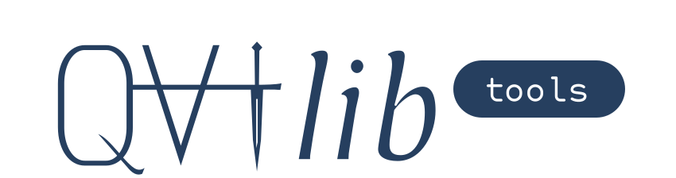

<picture>
  <source media="(prefers-color-scheme: dark)" srcset="./.github/assets/qatlib-tools-wordmark-dark.svg" />
  
</picture>

**Engineering handbook and reusable Lean tooling for Qatlib**

[简体中文](./README.md) ｜ English

---

## Pick a path

The handbook covers environment setup, builds, retrieval, and pull-request checks for [Qatlib](https://github.com/quantum-atlas-ai/qatlib). You can use `qatlib-env`, `qatlib-retrieve`, and `qatlib-forge` independently in other [Lean 4](https://lean-lang.org/) projects. Use `git`, `gh`, `tea`, `gt`, and `lake` directly to inspect branches, open pull requests, and build individual targets.

Read the English handbook online at <https://quantum-atlas-ai.github.io/qatlib-tools/en/> (generated from the matching files in `docs/en/`). After installation, you can also read the handbook offline, though the offline command serves the Chinese text: `qatlib-env docs` prints this file's Chinese counterpart (`README.md`), `qatlib-env docs --list` lists the Chinese topics directly under `docs/`, and `qatlib-env docs <topic>` prints one of them.

| What you want to do | Open |
| --- | --- |
| Check that the tools run on this machine | [Five-minute check](docs/en/quickstart.md) |
| Edit one module in a Lean repository that already pins the tools | [A second worktree](docs/en/worktrees.md) |
| Open a first draft pull request, or change this tools repository | [Pull requests](docs/en/pull-requests.md) · [Contributing](CONTRIBUTING.en.md) |
| Read this repository's workflows, review a commit, or attach a runner | [GitHub workflows](docs/en/github-ci.md) · [Reviewing concurrent commits](docs/en/forge.md) · [Self-hosted runners](docs/en/runner.md) |
| Share caches across repositories or diagnose a build fallback | [Cross-repository R2 caching](docs/en/r2-cache.md) · [Actions stage timing and cache fallback](docs/en/actions-timing.md) |
| Verify Lean proofs, exported interfaces, and axiom dependencies | [Proof verification and axiom auditing](docs/en/verification.md) · `qatlib-env docs verification` (Chinese) |

## Five-minute check

From a checkout of this tools repository, run these three commands in order:

1. `uv tool install .`
2. `qatlib-env docs --list`
3. `qatlib-env config explain --json`

This step is done once the terminal prints the topic list and one JSON configuration object. For the expected working directory, exact commands, and fields to read, follow the [five-minute check](docs/en/quickstart.md). For pinned commits, wheels, Windows, and using a downstream repository's locked version, see [Install](docs/en/install.md).

## Three commands

| Command | What it does |
| --- | --- |
| `qatlib-env` | Prepares locked Lean dependencies and the shared cache, runs a build inside the resource budget, and manages local worktrees |
| `qatlib-retrieve` | Searches Lean declarations, source signatures, and bibliography citations |
| `qatlib-forge` | Summarizes checks for a single pull-request head, and compares the expected commit before merging or deleting a branch |

Pass `--help` to any installed command for its exact options.

## Builds, caches, and the local budget

For a day-to-day edit, follow the sequence in [A second worktree](docs/en/worktrees.md): run `plan`, then `prepare`, then `run -- lake build`. To inspect capacity, effective values, and paths without fetching dependencies or acquiring a build-pool lease, run `qatlib-env config explain --json`.

Cache switches, the nine restore combinations, Windows cross-volume behavior, the seven configuration layers, and the files under `~/.qatlib` are documented in [Build environment, caching, and resource control](docs/en/build.md). Budget fields are under [Configuration precedence](docs/en/build.md#configuration), and directories are under [Local data directories](docs/en/build.md#local-paths).

## Retrieval

From inside a Lean project, run `qatlib-retrieve index`, then `qatlib-retrieve query`, and open the source that a hit points to. Indexing, bibliographies, and website links are compared in [Lean documentation, bibliography, and source retrieval](docs/en/lean-docs.md).

## Pull requests

To open a first draft, write a verification record that someone else can rerun, and read Checks for the current commit, follow [Pull requests](docs/en/pull-requests.md).

A review answers three questions: which head the existing checks measured, whether that evidence applies to the current pull request, and whether it is safe to merge now. Walk through that workflow in [Pull requests on GitHub and Gitea](docs/en/forge.md). The summary commands are `qatlib-forge pr checks`, `qatlib-forge pr paths`, `qatlib-forge pr merge`, and `qatlib-forge branch delete`; pass `--help` to see their options.

## Shared work entering the public library

Follow [How shared work enters the public library](docs/en/promotion.md) for whole-file migration, an ordinary `module` consumer probe, lock verification in a clean worktree, and the lock update after a release.

## Runners

To attach a host, follow [Self-hosted runners](docs/en/runner.md) in order:

1. Confirm the controllers.
2. Read `--help` from the pinned source.
3. Run `init`.
4. Run `register`.
5. Match labels.
6. Read the effective limits back.
7. Accept the result as that lane's service account.

Page-cache accounting, processes left after cancellation, and the Windows Job Object are indexed by symptom in [Runner troubleshooting](docs/en/runner-troubleshooting.md).

## Changing this tools repository

To run the local commands that match `.github/workflows/ci.yml` (including the human-contract check and the clean-environment wheel smoke test), see the [contributing guide](CONTRIBUTING.en.md#self-test). In this repository, `CI / test` runs for draft pull requests as well as documentation-only pull requests. Pages deployment is a separate workflow, described in [GitHub workflows](docs/en/github-ci.md).

This project is released under the [Apache License, Version 2.0](./LICENSE).
